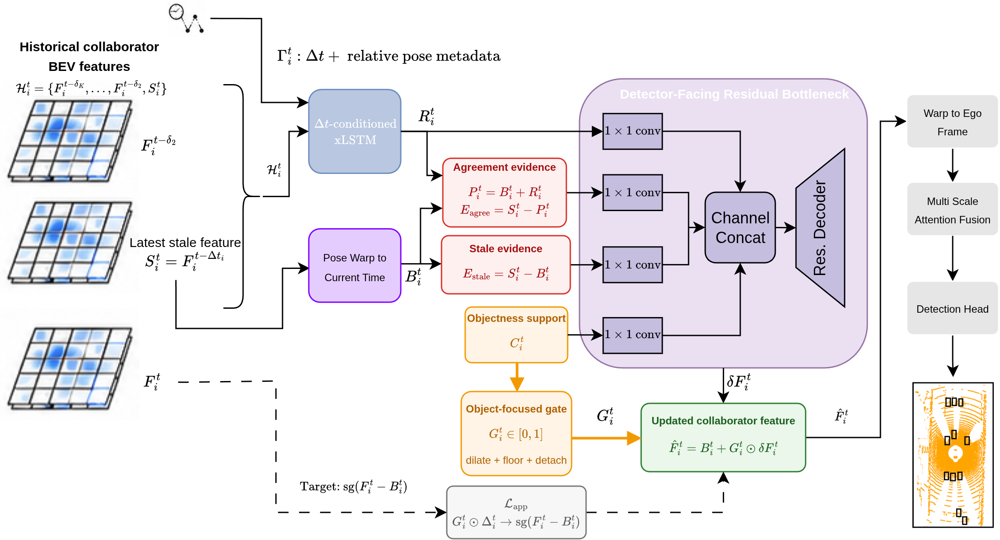

<h1 align="center">TempResCP</h1>

<h2 align="center">Temporal Residual Bottleneck for Robust<br>Asynchronous Collaborative Perception</h2>

<p align="center">
  <strong>Melih Yazgan · Ahmed Abouelazm · J. Marius Zöllner</strong><br>
  FZI Research Center for Information Technology · Karlsruhe Institute of Technology
</p>

<p align="center">
  <strong>Accepted at ACCV 2026</strong>
</p>

<p align="center">
  <a href="https://arxiv.org/abs/2610.10090"></a>
  <a href="https://arxiv.org/pdf/2610.10090">Paper + Supplement (PDF)</a>
</p>

Official repository for **TempResCP**. Code release is in preparation.



*Framework overview. A pose-warped collaborator feature provides a geometric anchor, while a time-conditioned xLSTM extracts temporal residual evidence from the available history. A residual bottleneck applies gated corrections before ego-frame fusion and detection.*

## Abstract

Collaborative perception extends the sensing range of autonomous vehicles, but its performance degrades when shared features arrive stale or incomplete. Most latency-robust methods compensate delayed collaborator features through flow-guided alignment or direct feature transport. In this work, we formulate asynchronous collaborative perception as temporal residual prediction. Our Temporal Residual Bottleneck keeps a deterministic pose-warped collaborator feature as a conservative anchor and uses a $\Delta t$-conditioned xLSTM to extract residual temporal evidence from the available history. A detector-facing residual bottleneck then applies only gated, regularized corrections before ego-side fusion, reducing the risk of overwriting reliable static structure when temporal correspondence is uncertain. Experiments on DAIR-V2X and OPV2V show that our method is especially effective under severe fixed/irregular delays and packet drops. On DAIR-V2X, the reported checkpoint trades a small amount of synchronized peak accuracy for better robustness under stronger communication degradation. Controlled diagnostics further indicate that direct feature transport has oracle headroom but can become unreliable when deployed without accurate correspondence. These results support temporal residual fusion as a practical alternative for asynchronous and incomplete collaborative perception. Code will be publicly released at [https://url.fzi.de/8dk38](https://url.fzi.de/8dk38).

## News

- Our paper has been accepted at **ACCV 2026**!
- **October 7, 2026:** The [paper and supplementary material](https://arxiv.org/abs/2610.10090) are available on arXiv.

## Release Plan

- [x] Paper and supplementary material
- [ ] Code release — coming soon

## Citation

If you find this work useful for your research, please consider citing our paper:

```bibtex
@misc{yazgan2026temporalresidual,
  title         = {Temporal Residual Bottleneck for Robust Asynchronous Collaborative Perception},
  author        = {Melih Yazgan and Ahmed Abouelazm and J. Marius Z{\"o}llner},
  year          = {2026},
  eprint        = {2610.10090},
  archivePrefix = {arXiv},
  primaryClass  = {cs.CV},
  url           = {https://arxiv.org/abs/2610.10090}
}
```
